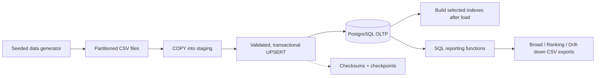

# E-commerce OLTP System — Reliable Data Loading & SQL Performance

**Python · PostgreSQL 16 · Docker · uv · SQL performance engineering**

A hands-on Data Engineering project that builds an e-commerce transactional database from synthetic data, loads millions of rows safely, and serves SQL reports. The main challenge is not just making queries faster: it is **balancing reporting performance with the cost of running an OLTP system**.

| Scale & scope | Engineering outcome |
|---|---|
| **5 million orders + 17.5 million order items** across five months | Reproducible generation and recoverable bulk loading |
| **12 reporting functions**, **37 benchmark cases** | SQL rewriting, query-plan analysis, and measured indexing |
| **26 reporting sessions/day** in the illustrative business scenario | A cost-aware recommendation: **2 optional indexes**, not every index that benchmarks well |

> The data is synthetic, and reporting frequency is an explicit business assumption—not observed production traffic.

## 1. The problem

Imagine a mid-sized marketplace with **50 sellers** and **3,000 products**. PostgreSQL handles its daily orders and operational updates. A small internal team also uses it for management summaries, seller investigations, and rankings; the business has not introduced a separate data warehouse.

This creates three engineering questions:

1. **How do we load a large dataset without making failures expensive to recover from?**
2. **How do we write reporting SQL that performs well on transactional tables?**
3. **Which indexes are worth maintaining when inserts and updates remain the priority?**

The modeled reporting demand is **4 management, 18 seller drill-down, and 4 ranking sessions/day**. Each session calls several SQL queries, giving **104 modeled SQL executions/day**. Drill-down should feel responsive; less frequent full-history summaries can take longer.

## 2. How the system works



The Python CLI orchestrates the workflow; PostgreSQL performs the bulk loading, joins, aggregation, and reporting logic. Docker Compose runs PostgreSQL and pgAdmin on the same network, so pgAdmin connects to the database by the service name **`db`** instead of a container IP address.

### Engineering decisions that matter

| Area | Design choice | Why it matters |
|---|---|---|
| **Synthetic data** | Fixed seed, consistent business IDs, validated dates, paired order/item CSV parts | Reproducible datasets and reliable foreign-key relationships |
| **Bulk ingestion** | PostgreSQL `COPY` into staging, then transactional `UPSERT` | Faster batch ingestion without giving up validation and database constraints |
| **Recovery** | Per-file commits, checksums, atomic checkpoints, and resumable loading | A failed batch can be retried without restarting the entire load |
| **Index build order** | Load data first, create selected reporting indexes afterward | Avoid maintaining those indexes row by row during the initial bulk load |
| **SQL optimization** | Set-based filtering and aggregation; membership checks with `EXISTS` / semi-joins and exclusion checks with `NOT EXISTS` / anti-joins | Avoid unnecessary duplicate rows and repeated row-by-row work; verify the *actual* join strategy with `EXPLAIN` |
| **Index selection** | Examine selective, broad, and Top-K plans before choosing a minimal set | An index that accelerates a query can still be too expensive or unnecessary to maintain |
| **Reporting** | 12 parameterized, read-only SQL functions exposed through grouped CLI commands | Reusable business logic and organized CSV exports |

An `EXISTS` condition answers **“does a matching row exist?”** (a semi-join strategy); `NOT EXISTS` answers **“does no matching row exist?”** (an anti-join strategy). These are particularly useful for checking related orders/items and applying soft-deletion rules. They are SQL techniques, not a guarantee that PostgreSQL will choose a particular physical plan; the project inspects `EXPLAIN (ANALYZE, BUFFERS)` to confirm what actually happens.

See the [loader design](src/ecommerce_oltp_system/loader/README.md), [recovery decisions](docs/decisions/recoverable-load.md), and [reporting catalog](database/reporting/README.md).

## 3. What the experiments showed

### Bulk loading: build optional indexes *after* loading

A separate full-data experiment compared two ways to reach an indexed database state, using the **same four performance indexes** for both strategies:

| Strategy | Total time |
|---|---:|
| Load the data, then build indexes | **456.742 s** |
| Build indexes first, then load the data | **560.001 s** |
| **Time saved by deferring index creation** | **103.259 s** |

The result supports a simple initial-load strategy: **use `COPY`/staging for the data, then build optional indexes when the load is complete**. This was a one-off bulk-load experiment, not a measurement of production insert throughput or the write cost of the final two-index recommendation.

### Query performance: different problems need different solutions

The SQL experiments evaluated **12 reporting functions across 37 cases**. Selected results below use one consistent, separately validated benchmark cohort (October 30, 2026); each value is the median of seven measured executions after three warmups.

| Query pattern | Example | Before | After | What helped |
|---|---|---:|---:|---|
| **Broad** | Seller performance across all sellers | **14.439 s** (original SQL) | **9.165 s** (rewritten SQL) | Less unnecessary SQL work; large scans can still be appropriate |
| **Selective** | Seller performance with filters | **1.150 s** (rewritten, no optional indexes) | **0.026 s** (two selected indexes) | Product-leading covering access instead of scanning unrelated items |
| **Selective** | Brand ranking with filters | **1.439 s** (rewritten, no optional indexes) | **0.149 s** (two selected indexes) | Better access to the relevant product/item subset |
| **Top-K** | Highest-value order | **645.653 ms** (without optional indexes) | **0.011 ms** (with an amount-ordered index) | Read the first matching index entry and stop—but this index was **not** selected |

The distinction matters: **selective** queries can avoid reading irrelevant rows, whereas **broad** reports often must process much of the dataset. **Top-K** lookups can use index order to stop early, but a very large speedup is not automatically a business need.

### The decision: why recommend only two indexes?

The experiment explored **nine optional index candidates**. Seven were useful enough to retain under an earlier read-performance objective, but the final business review asks a different question: **does the extra speed justify the index's storage and ongoing OLTP maintenance?**

| Configuration | Modeled seller drill-down SQL/session | Optional-index storage |
|---|---:|---:|
| Rewritten SQL; no optional indexes | **4.995 s** | 0 MiB |
| **Recommended C1 + C2** | **0.735 s** | **826.602 MiB** |
| Full seven-index experiment | **0.696 s** | **2,233.844 MiB** |

The two selected indexes address repeated interactive work: a small partial index for deleted-parent checks (**C1**) and a product-leading covering index for selective item access (**C2**). The other five add about **1,407 MiB** while improving the modeled drill-down sum by only about **39 ms/session**. Some help infrequent broad reports or already-subsecond lookups; those gains do not currently justify their extra maintenance.

**Recommendation ≠ deployment:** C1+C2 is the provisional, measured recommendation for a new installation; it is not proven globally optimal. The repository's historical `database/indexes.sql` still records seven experimental definitions. The CLI's `--indexes recommended` option selects only C1+C2 and does **not** remove indexes already installed in a database.

For measured comparisons, slower cases, and trade-offs, see the [SQL optimization case study](reports/SQL_Optimization_README.md) and its [analysis limits](reports/SQL_Optimization_README.md#limits-of-this-analysis).

## 4. Run a local demo

Requires **Python 3.12+, uv, Docker Engine, and Docker Compose**. The example below creates only **1,000 orders**, not the full benchmark dataset.

```bash
cp -n .env.example .env
cp -n database.ini.example database.ini
uv sync --locked
docker compose up -d --wait

uv run ecommerce generate --output-dir data-demo --orders 1000 --orders-per-file 500 --seed 42
uv run ecommerce load --data-dir data-demo --indexes recommended
uv run ecommerce report broad --start 2025-01-01 --end 2025-06-01
uv run ecommerce report ranking --start 2025-01-01 --end 2025-06-01
uv run ecommerce report drill-down --sellers 1,2 --start 2025-01-01 --end 2025-06-01
```

Before loading, match the credentials in `database.ini` to `.env` and use a **fresh database**. CSV reports appear under `reports/results/broad/`, `reports/results/ranking/`, and `reports/results/drill-down/`.

- **pgAdmin:** [http://localhost:5050](http://localhost:5050); register PostgreSQL with host **`db`**, port **`5432`**.
- **Command overview:** `uv run ecommerce --help` and `uv run ecommerce report list`.
- **Full instructions and safe setup:** [Local setup & CLI guide](docs/usage/usage-guide.md).

## 5. Documentation and testing

| Explore | Documentation |
|---|---|
| Setup, Docker, pgAdmin, generation, loading, CSV reports | [Local setup & CLI guide](docs/usage/usage-guide.md) |
| Ingestion stages, idempotency, and checkpoints | [Loader](src/ecommerce_oltp_system/loader/README.md) · [Recovery design](docs/decisions/recoverable-load.md) |
| SQL functions and parameters | [Reporting catalog](database/reporting/README.md) |
| SQL rewrites, execution plans, benchmarks, index decisions | [Optimization case study](reports/SQL_Optimization_README.md) · [Measurement methodology](reports/SQL_Optimization_README.md#4-how-i-measured-it) |
| Automated checks | [Tests](tests/README.md) · [CI verification](.github/workflows/verify.yml) |

```bash
uv run python -m unittest discover -s tests/unit -v
```

**Measurement boundaries:** Query timings are from standalone SQL on an isolated PostgreSQL copy, not measured end-to-end dashboard latency. The benchmark used reconstructed parameters, and host/cache variation remains possible. The business workload is illustrative, while live OLTP write overhead and concurrency effects were not measured. The bulk-load comparison is a separate experiment.

**Takeaway:** Build reliable pipelines, improve expensive SQL, and create **only the indexes whose benefits are meaningful for the workload**.
