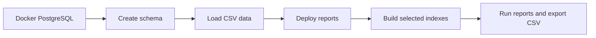

# PostgreSQL Database & SQL Assets

This directory contains the SQL behind the e-commerce OLTP system: **table definitions, reporting functions, and optional performance indexes**. Python handles data generation, loading, and CSV export; PostgreSQL owns the data constraints and reporting calculations.

## What's in this directory?

| Path | Responsibility |
|---|---|
| [`schema.sql`](schema.sql) | Symlink to the [canonical packaged schema](../src/ecommerce_oltp_system/loader/sql/schema.sql): tables, constraints, staging, and loader checkpoints. |
| [`reporting/`](reporting/README.md) | Twelve parameterized reporting functions, standalone SQL examples, and original SQL for comparison. |
| [`indexes.sql`](indexes.sql) | Seven **historical** optional index definitions from the tuning experiments. |

## From an empty database to reports



From the repository root, with Docker Compose and uv configured:

```bash
cp -n .env.example .env
cp -n database.ini.example database.ini
docker compose up -d --wait

uv run ecommerce generate --output-dir data-demo --orders 1000 --seed 42
uv run ecommerce load --data-dir data-demo --indexes recommended
uv run ecommerce report broad --start 2025-01-01 --end 2025-06-01
```

The `load --indexes recommended` command creates the application schema if needed, loads data, then deploys reporting functions and the **two recommended optional indexes**. Use a **fresh database** for this sample; do not load it into a populated historical dataset.

For existing installations, the commands have distinct purposes:

| Command | What it does |
|---|---|
| `uv run ecommerce init-db` | Create application tables and mandatory constraints only. |
| `uv run ecommerce load --data-dir data-demo` | Load data; **no automatic reporting/index deployment** by default. |
| `uv run ecommerce setup --indexes recommended` | Deploy reporting functions and create the two recommended indexes without loading data. |
| `uv run ecommerce setup --indexes none` | Deploy functions while **skipping** optional index creation. |

> `--indexes none` does **not** drop indexes that already exist. Setup also does not remove historical indexes from an existing database.

## Index design: performance with a cost

PostgreSQL automatically maintains the **25 mandatory PK/UNIQUE indexes** required by the schema. These are not optional tuning candidates.

The current **provisional recommendation** adds only:

| Optional index | Purpose |
|---|---|
| `order_order_id_deleted_idx` (C1) | Efficiently check deleted parent orders where report logic requires it. |
| `order_item_product_order_cover_idx` (C2) | Speed up selective reporting by providing product-leading access to order items and covered values. |

**Why only two?** More indexes can improve particular broad reports and Top-K lookups, but they also consume space and require maintenance during OLTP writes. The decision is based on the modeled reporting workload, not the largest possible benchmark speedup.

`indexes.sql` deliberately preserves **all seven historically accepted definitions** for auditability. Running that entire file installs seven indexes; `--indexes recommended` selects **only C1+C2**. Index creation uses standard `CREATE INDEX`, so builds may block writes. The benchmark supports **loading first and creating optional indexes afterward** for an initial bulk load.

See the [SQL optimization case study](../reports/SQL_Optimization_README.md) for the measured gains, regressions, storage costs, and assumptions behind the recommendation.

## Where to go next

- **Reporting semantics and SQL examples:** [Reporting catalog](reporting/README.md)
- **Docker, pgAdmin, CLI, and troubleshooting:** [Usage guide](../docs/usage/usage-guide.md)
- **Transactions and checkpoint recovery:** [Recoverable-load decision](../docs/decisions/recoverable-load.md)

**Safety:** Docker creates the PostgreSQL database only when initializing an empty data volume. Existing volumes and credentials are not reset by these commands. For pgAdmin inside Compose, connect to PostgreSQL using hostname `db` and port `5432`; host-side clients use the published `localhost` port.
