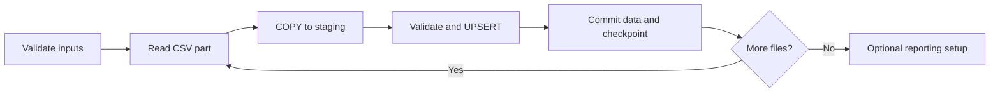

# Design Decision: Recoverable Bulk Loading

**Problem:** Loading millions of orders and order items takes time. If one file fails near the end, restarting the entire dataset would waste work and make recovery harder.

**Decision:** Load data in **small, committed units**, record a checkpoint alongside each successful unit, and install optional reporting indexes **after** the data load.

## How it works

| Engineering choice | Why it matters |
|---|---|
| **Preflight validation** | Check configuration, required files, matching order/item part numbers, and requested SQL assets before connecting. |
| **`COPY` + staging** | Ingest CSV batches efficiently, then apply validation and database constraints before writing final rows. |
| **One transaction per file** | A failed file rolls back without undoing earlier successful files. |
| **Data + checksum checkpoint in one commit** | A file is marked complete only when its data has committed successfully. |
| **Load parents before children** | Preserve order/item relationships and generated order IDs. |
| **Separate reporting setup** | Install reporting functions and, when requested, C1+C2 indexes only after ingestion succeeds. |

## Recovery scenarios

| What fails? | What remains? | How to recover |
|---|---|---|
| Configuration or input preflight | No database changes from the command | Correct the input or options, then rerun. |
| A CSV file or order/item part | Previously committed files remain; the failed file rolls back | Fix the cause and rerun with the **same unchanged input files**. |
| Reporting or index setup | Loaded data and checkpoints remain; setup transaction rolls back | Fix the issue, then run `uv run ecommerce setup --indexes recommended` with the same connection and SQL settings. |

For example, an order part may commit before its matching item part fails. On retry, the loader skips the checkpointed order file and resumes with the unfinished item file.

**Important:** If a previously completed CSV changes, its checksum no longer matches the checkpoint. Restore the original file or use a fresh, isolated database and dataset. **Do not delete checkpoints to bypass this protection.**

## Why build optional indexes after loading?

The initial bulk load should not pay the cost of maintaining every optional reporting index for each inserted row. In a separate full-data experiment using the same four performance indexes, building indexes **after** loading took **456.742 seconds**, compared with **560.001 seconds** when the indexes were present during loading.

That result supports the initial-load strategy; it **does not measure ongoing production INSERT/UPDATE overhead** or the exact cost of the currently recommended C1+C2 set. Mandatory PK/UNIQUE indexes remain in place throughout.

## Trade-offs and verification

File-level commits make retries practical, but the database can be **partially loaded** while ingestion is still running. Treat the dataset as complete only after the loader finishes successfully. Standard `CREATE INDEX` can block writes, so initial optional index setup belongs in an appropriate maintenance window.

The design is implemented and checked by [checkpoint/recovery integration tests](../../tests/integration/test_loader_checkpoints.py) and the [end-to-end CLI smoke test](../../tests/integration/test_cli_smoke.py). These verify correctness and retry behavior, not full-scale production performance.

**Try it:** Follow the [local setup guide](../usage/usage-guide.md) or inspect the [loader implementation](../../src/ecommerce_oltp_system/loader/README.md).
